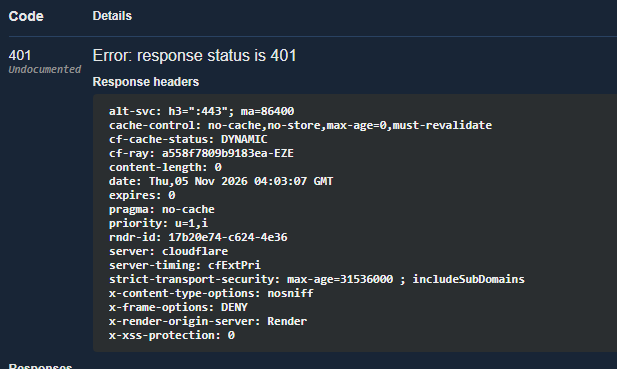
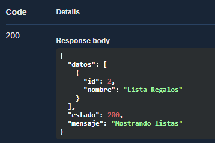
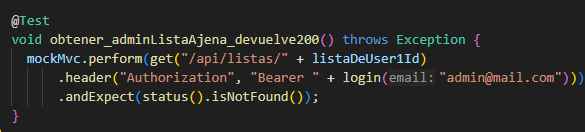
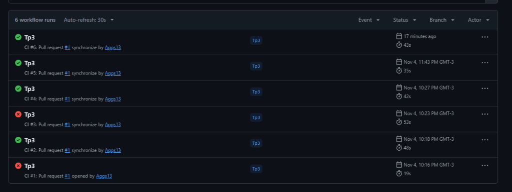
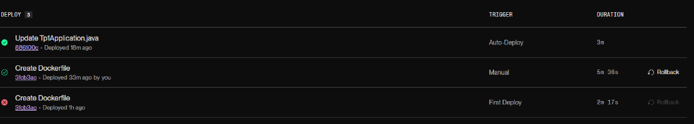

# TP1, TP2 y TP3 — Programación Web 2

> **🌐 URL Pública en Producción (Render):** [https://tp1-web2-6udz.onrender.com](https://tp1-web2-6udz.onrender.com)
> - **Swagger UI:** [https://tp1-web2-6udz.onrender.com/swagger-ui/index.html#/](https://tp1-web2-6udz.onrender.com/swagger-ui/index.html#/)
> - **Health Check (`GET /health`):** [https://tp1-web2-6udz.onrender.com/health](https://tp1-web2-6udz.onrender.com/health)
> - **Workflow de GitHub Actions (CI):** [https://github.com/Aggs13/Tp1-Web2/actions/workflows/ci.yml](https://github.com/Aggs13/Tp1-Web2/actions/workflows/ci.yml)

---

# TP3 — Seguridad (JWT), Testing, CI y Despliegue

## 1. Autenticación y uso en Swagger
- **Endpoints públicos:** `/health`, `/api/auth/registro`, `/api/auth/login` y `/api/productos/**`.
- **Endpoints protegidos (requieren Bearer JWT):** `/api/listas/**` y `/api/favoritos/**` (sin token o con token inválido responden `401 Unauthorized`).
- **Cómo probar en Swagger:**
  1. Registrar un usuario en `POST /api/auth/registro`.
  2. Iniciar sesión en `POST /api/auth/login` y copiar el token devuelto en el campo `datos`.
  3. Hacer clic en el botón **`Authorize` 🔒** arriba a la derecha de Swagger, pegar el token y confirmar.

### Evidencia en Producción (`/api/listas`)

#### A. Petición a endpoint protegido (`/api/listas`) SIN token → `401 Unauthorized`


#### B. Petición a endpoint protegido (`/api/listas`) CON token válido → `200 OK`


---

## 2. Autorización: dónde vive la regla y por qué (Punto 4)

La regla de autorización sobre la propiedad de las listas (`validarPropiedadLista`, que verifica que `lista.usuarioId` coincida con el usuario autenticado en el `SecurityContext` o que tenga el rol `ROLE_ADMIN`) vive en la **capa de Servicio (`ListaServiceImplement`)** y no en el `Controller` ni en un filtro HTTP:

- **¿Por qué en el Service y no en el Controller?**
  1. **Es una regla de negocio / dominio:** Decidir primero si la lista existe (`404 Not Found`) y luego si el usuario actual es dueño o `ADMIN` (`403 Forbidden` mediante `AccesoDenegadoException`) requiere consultar el repositorio (`BuscarListaPorId`). El Controller solo debe ocuparse de recibir el request HTTP, validar el formato de entrada y devolver la respuesta, sin mezclar lógica de negocio ni acceso a datos.
  2. **Reutilización y consistencia:** En operaciones compuestas como `moverFavoritos(origenId, destinoId)` hay que validar tanto la lista origen como la destino dentro de una misma transacción. Centralizar la validación en el Service evita duplicar chequeos en cada endpoint del Controller.
  3. **¿Por qué no en el filtro JWT?** El filtro (`JwtFilter`) trabaja a nivel de URL/transporte autenticando el token antes de llegar a la lógica de negocio; no conoce ni debe consultar la base de datos para saber a qué `usuario_id` pertenece el `{id}` de una lista puntual.

---

## 3. Cómo correr los Tests (Punto 5)

El proyecto separa las pruebas unitarias de las de integración mediante **Maven Surefire** y **Maven Failsafe**:

- **Correr únicamente las pruebas unitarias (`*Test.java` — JUnit 5 + Mockito, sin levantar Spring ni base de datos):**
  ```bash
  ./mvnw test
  ```
  - Ejecuta `UsuarioServiceImplementTest` y `ListaServiceImplementTest`.

- **Correr todo el ciclo (pruebas unitarias `*Test` + pruebas de integración `*IT.java` con Testcontainers):**
  ```bash
  ./mvnw verify
  ```
  - Además de los tests unitarios, Failsafe ejecuta `ListaControllerIT`, que levanta un contenedor PostgreSQL real y descartable vía **Testcontainers**, aplica las migraciones Flyway `V1–V7` desde cero y prueba los flujos HTTP completos con `MockMvc` (`200`, `401`, `403`).
  - *(Requisito: tener Docker Desktop corriendo en local).*

---

## 4. Integración Continua — Cómo leer el resultado de CI (Punto 6)

- **Link al workflow:** [https://github.com/Aggs13/Tp1-Web2/actions/workflows/ci.yml](https://github.com/Aggs13/Tp1-Web2/actions/workflows/ci.yml)

El workflow está configurado en [`.github/workflows/ci.yml`](.github/workflows/ci.yml) y se dispara automáticamente en cada `push` y `pull_request` ejecutando `./mvnw verify`:

1. En el repositorio de GitHub, ir a la pestaña **Actions**.
2. Cada commit muestra el estado del job **`build-and-test`**:
   - **✅ Verde (Success):** El proyecto compiló con JDK 25 y pasaron tanto los tests unitarios (`Surefire`) como los de integración contra PostgreSQL en Testcontainers (`Failsafe`).
   - **❌ Rojo (Failure):** Algún test o migración falló, deteniendo el pipeline.

### Evidencia de verificación del Workflow (Fallo forzado y corrección)

Para comprobar que el workflow detecta fallos en los tests, se modificó intencionalmente `obtener_adminListaAjena_devuelve200()` en `ListaControllerIT` cambiando `status().isOk()` por `status().isNotFound()`:



Al subir el cambio (`CI #3`), el workflow falló en rojo (**❌**) y, tras restaurar `status().isOk()` (`CI #4`, `CI #5`, `CI #6`), volvió a pasar en verde (**✅**):



---

## 5. Pasos seguidos para el Despliegue en Producción (Punto 7)

El despliegue se realizó en **Render** usando contenedores Docker y una instancia administrada de PostgreSQL:

1. **Dockerización (`Dockerfile`):** Se creó un `Dockerfile` *multi-stage* en la raíz del proyecto:
   - Etapa `build` (`eclipse-temurin:25-jdk`): compila el proyecto y empaqueta el `.jar` con `./mvnw clean package -DskipTests`.
   - Etapa de ejecución (`eclipse-temurin:25-jre`): copia el `.jar` compilado y expone el puerto `8081`.
2. **Base de datos PostgreSQL en Render:**
   - Se creó una instancia **PostgreSQL 16 (Free)** en Render (`web2_bd`) en la misma región (`Virginia - US East`).
3. **Web Service en Render:**
   - Se conectó el repositorio de GitHub `Aggs13/Tp1-Web2` seleccionando `Language: Docker`.
   - Se configuraron las variables de entorno en la pestaña **Environment** de Render (sin subir secretos al repositorio):
     - `SPRING_DATASOURCE_URL`: `jdbc:postgresql://<internal-hostname>:5432/web2_bd`
     - `SPRING_DATASOURCE_USERNAME` y `SPRING_DATASOURCE_PASSWORD`: credenciales provistas por Render PostgreSQL.
     - `JWT_SECRET`: clave secreta para la firma HMAC-SHA256 de los tokens.
     - `SERVER_PORT`: `8081`.
4. **Migraciones automáticas:** Al iniciar el contenedor en Render, Flyway ejecutó y validó automáticamente las 7 migraciones (`V1–V7`) sobre la base de producción.
5. **URLs públicas desplegadas:**
   - Base URL: [https://tp1-web2-6udz.onrender.com](https://tp1-web2-6udz.onrender.com)
   - Swagger UI: [https://tp1-web2-6udz.onrender.com/swagger-ui/index.html#/](https://tp1-web2-6udz.onrender.com/swagger-ui/index.html#/)
   - Health Check: [https://tp1-web2-6udz.onrender.com/health](https://tp1-web2-6udz.onrender.com/health)

### Historial de despliegues en Render


---

# TP2 — Persistencia, migraciones y arquitectura hexagonal

## 4. Puertos y adaptadores: qué cambió y qué no

**Tuve que tocar (infraestructura):**
- Eliminado el repository en memoria; nuevo `FavoritoRepositoryAdapter` + `FavoritoEntity` + `FavoritoJpaRepository` (y lo mismo para `Lista`).
- Nuevas migraciones Flyway `V1–V5` y `ddl-auto=validate` (el esquema lo maneja Flyway, no Hibernate).

**Quedaron iguales (dominio y aplicación):**
- `model` (`Favorito`, `Lista`), services (`FavoritosService`, `ListaService`), controllers y DTOs (solo sumaron `listaId` por el punto 5 y se ordenaron en carpetas).
- `GlobalExceptionHandler` solo sumó casos (`400` por id inválido, `409` por conflicto), no cambió su forma.

**Por qué fue posible:** los services dependen del puerto (`FavoritosRepository` / `ListaRepository`, una interfaz) y no de quién lo implementa. Migrar de memoria a JPA fue cambiar el bean detrás de esa misma interfaz (el adapter), sin tocar el contrato; por eso el service ni se enteró.

## 6. Evolución del esquema

Esto se resuelve con una migración nueva (`V5__lista_id_obligatorio.sql`) y nunca editando una ya aplicada, porque Flyway guarda el checksum de cada migración corrida: si modificás `V1`–`V3` después de aplicadas, la app no arranca. `V5` crea "Sin clasificar", reasigna los `lista_id NULL` y recién ahí declara el `NOT NULL`.

## 7. Transacciones

`POST /api/listas/{origenId}/mover-favoritos` hace N `UPDATE`s (reasignar cada favorito) + 1 `DELETE` (la lista origen) bajo un `@Transactional` en `ListaService.moverFavoritos`. Sin él, si el `DELETE` fallara después de los `UPDATE`s ya confirmados, quedaría una mudanza a medias (favoritos en destino con la origen todavía viva), violando la atomicidad de ACID. Con `@Transactional` es todo o nada: ante un fallo hace rollback y la base queda como antes.

## 8. Documentación (Local)

### Levantar PostgreSQL local

1. Copiar `.env.example` como `.env` y completar las variables.
2. `docker compose up -d` (imagen `postgres:16`, contenedor `tp2-postgres`, puerto `5433`, datos en volumen `pgdata`).
3. Correr la app (`Tp1Application`).
4. El esquema lo aplica Flyway (`ddl-auto=validate`, Hibernate no toca el DDL).

---

# TP1 — Cómo levantar y probar (VS Code)

> Puerto usado: **8081** (ver `application.properties`).

## 1. Levantar
1. Abrí la carpeta `Tp1` en VS Code.
2. Abrí `src/main/java/Web2/Tp1/Tp1Application.java`.
3. Apretá **Run** arriba del `main`.
4. Esperá `Started Tp1Application`.

## 2. Probar en Swagger
Abrí: http://localhost:8081/swagger-ui.html
